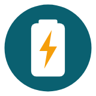
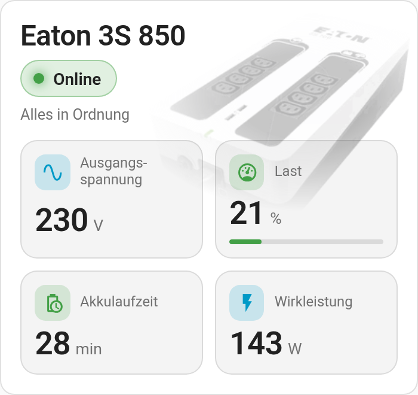

  

# Eaton UPS Card

**English** | [Deutsch](https://github.com/BeGiBue/home-assistant-eaton-ups-card#deutsch)

## English

Responsive Home Assistant dashboard card for an Eaton 3S 850 UPS.

### Features

- Automatic evaluation of typical NUT status values
- Output voltage, load with progress bar (orange from 70 %, red from 90 %), battery runtime and active power
- Tapping a reading opens the Home Assistant more-info dialog
- Built for portrait and touch: iPhone, iPad and Raspberry Pi kiosk
- Built-in product image, visual editor, follows your theme

The card is shown in German when Home Assistant is set to German, and in English otherwise.

### Requirements

- An integration such as NUT must already provide the UPS entities; the card does not connect to the UPS itself.
- The default entity IDs are examples and must match your installation. The card does not monitor or switch the UPS itself.

### Status evaluation

`status_entity` and `status_data_entity` are evaluated together:

- `OL` / `ONLINE` → Online / All OK
- `OL CHRG` / `CHARG` → On mains / Battery charging
- `OB` / `ON BATTERY` → On battery
- `LB` / `LOW` → Battery low
- `BYPASS` → Bypass
- `OVER` → Overload
- `FAULT` / `FSD` → Fault
- `OFF` → Off

Unavailable values are shown as "—".

### Image

The default Eaton 3S 850 image is embedded in `eaton-ups-card.js`. If a custom image URL (e.g. `image: /local/images/my_ups.png`) cannot be loaded, the card falls back to it.

### Layout

On narrow cards the four readings form a 2×2 grid; from about 700 px card width they sit in one row. Width is set in Home Assistant's **Layout** settings. There is no fixed height; it follows the content, and the card reports its minimum height (`min_rows`) to the layout editor.

Independent community project, not affiliated with, endorsed or published by Eaton or Home Assistant. **Eaton** and **Eaton 3S** are trademarks of their respective owners. The project logo is an independent community logo, not the official Eaton logo. License: [AGPL-3.0-only](https://github.com/BeGiBue/home-assistant-eaton-ups-card/blob/main/LICENSE).

## Deutsch

[English](https://github.com/BeGiBue/home-assistant-eaton-ups-card#english) | **Deutsch**

Responsive Home-Assistant-Dashboard-Karte für eine Eaton 3S 850 USV.

### Funktionen

- Automatische Auswertung typischer NUT-Statuswerte
- Ausgangsspannung, Last mit Fortschrittsbalken (orange ab 70 %, rot ab 90 %), Akkulaufzeit und Wirkleistung
- Tippen auf einen Messwert öffnet den Mehr-Informationen-Dialog
- Optimiert für Hochformat und Touch: iPhone, iPad und Raspberry-Pi-Kiosk
- Eingebettetes Produktbild, grafischer Editor, folgt dem Theme

Die Karte erscheint auf Deutsch, wenn Home Assistant auf Deutsch eingestellt ist, sonst auf Englisch.

### Voraussetzungen

- Eine Integration wie NUT muss die USV-Entitäten bereitstellen; die Karte verbindet sich nicht selbst mit der USV.
- Die Standard-Entity-IDs sind Beispiele und müssen zur eigenen Installation passen. Die Karte überwacht und schaltet die USV nicht selbst.

### Statusauswertung

`status_entity` und `status_data_entity` werden gemeinsam ausgewertet:

- `OL` / `ONLINE` → Online / Alles in Ordnung
- `OL CHRG` / `CHARG` → Netzbetrieb / Akku wird geladen
- `OB` / `ON BATTERY` → Batteriebetrieb
- `LB` / `LOW` → Akku niedrig
- `BYPASS` → Bypass
- `OVER` → Überlast
- `FAULT` / `FSD` → Störung
- `OFF` → Ausgeschaltet

Nicht verfügbare Werte werden als „—“ angezeigt.

### Bild

Das Standardbild der Eaton 3S 850 ist in `eaton-ups-card.js` eingebettet. Kann eine eigene Bild-URL (z. B. `image: /local/images/meine_usv.png`) nicht geladen werden, fällt die Karte darauf zurück.

### Layout

Bei schmaler Karte stehen die vier Messwerte im 2×2-Raster, ab ca. 700 px Kartenbreite in einer Reihe. Die Breite wird über die **Layout**-Einstellungen festgelegt. Eine feste Höhe gibt es nicht; sie ergibt sich aus dem Inhalt, und die Karte meldet dem Layout-Editor ihre Mindesthöhe (`min_rows`).

Unabhängiges Community-Projekt, ohne Verbindung zu Eaton oder Home Assistant und von beiden weder unterstützt noch herausgegeben. **Eaton** und **Eaton 3S** sind Marken ihrer jeweiligen Rechteinhaber. Das Projektlogo ist ein eigenständiges Community-Logo und nicht das offizielle Eaton-Logo. Lizenz: [AGPL-3.0-only](https://github.com/BeGiBue/home-assistant-eaton-ups-card/blob/main/LICENSE).
